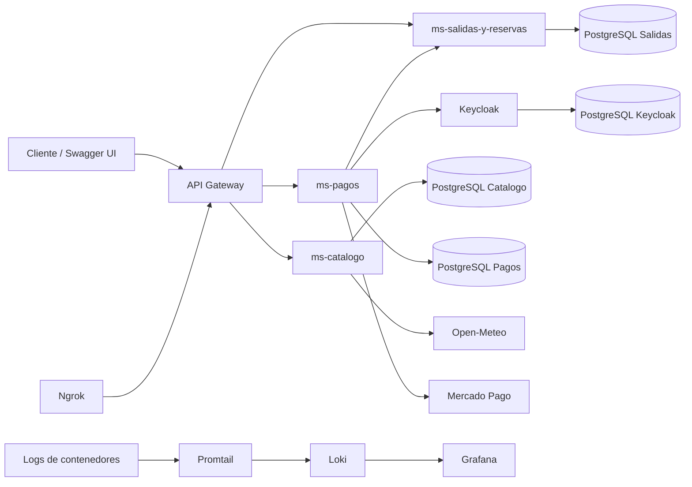

# TPI Backend

Backend para la plataforma de turismo TPI. Expone una API a través de un
API Gateway y distribuye las funcionalidades entre microservicios de
catálogo, salidas, reservas y pagos.

## Contenido

- [Arquitectura](#arquitectura)
- [Tecnologías](#tecnologías)
- [Requisitos](#requisitos)
- [Configuración](#configuración)
- [Ejecución local](#ejecución-local)
- [Servicios y puertos](#servicios-y-puertos)
- [Documentación y autenticación](#documentación-y-autenticación)
- [API](#api)
- [Pagos y webhook](#pagos-y-webhook)
- [Logs](#logs)
- [Comandos útiles](#comandos-útiles)
- [Consideraciones de seguridad](#consideraciones-de-seguridad)

## Arquitectura



El Gateway concentra el acceso HTTP y enruta las solicitudes a los servicios.
Keycloak emite los tokens JWT; el Gateway y los microservicios validan esos
tokens. Los microservicios se comunican por DNS interno de Docker Compose.

| Módulo | Responsabilidad |
|---|---|
| `gateway` | Entrada de la API, enrutamiento y validación JWT |
| `ms-catalogo` | Actividades y evaluaciones de viento con Open-Meteo |
| `ms-salidas-y-reservas` | Salidas y reservas |
| `ms-pagos` | Pagos con Mercado Pago y procesamiento de notificaciones |
| `tpi-common` | Librería compartida por los microservicios |
| `keycloak/` | Exportación del realm `tpi` |
| `grafana/`, `loki/`, `promtail/` | Provisionamiento y recolección de logs |

Cada microservicio tiene su propia base PostgreSQL. Las bases y los servicios
internos no publican puertos en el host, excepto los puertos indicados en
[Servicios y puertos](#servicios-y-puertos).

## Tecnologías

- Java 21 para los servicios; `tpi-common` compila con compatibilidad Java 17.
- Spring Boot, Spring Security, Spring Data JPA y Spring Cloud Gateway.
- PostgreSQL 16.
- Keycloak 24 para identidad y tokens JWT.
- OpenAPI / Swagger UI.
- Mercado Pago SDK para Java y API Open-Meteo.
- Docker Compose, Grafana, Loki y Promtail.

## Requisitos

- Docker Desktop iniciado y con soporte para Docker Compose v2.
- Git Bash en Windows para ejecutar `build.sh`.
- Acceso a Internet para descargar imágenes y dependencias durante el primer
  build.
- Credenciales de desarrollo para las integraciones que se quieran utilizar:
  Keycloak, Mercado Pago y ngrok.

No hace falta instalar Java ni Maven en el host para usar el flujo de build
incluido: `build.sh` ejecuta Maven dentro de un contenedor.

## Configuración

1. Crear el archivo local de variables de entorno:

   ```bash
   cp .env.example .env
   ```

2. Editar `.env` y reemplazar todos los valores descriptivos de ejemplo por
   valores válidos. No completar credenciales reales en `.env.example`.

Las variables se agrupan por servicio:

| Grupo | Variables |
|---|---|
| PostgreSQL de Keycloak | `DB_NAME_KC_PG`, `DB_USER_KC_PG`, `DB_PASSWORD_KC_PG`, `DB_URL_KC_PG` |
| Keycloak | `KEYCLOAK_ADMIN`, `KEYCLOAK_ADMIN_PASSWORD`, `KEYCLOAK_ISSUER_URI`, `KEYCLOAK_SERVICE_CLIENT_ID`, `KEYCLOAK_SERVICE_CLIENT_SECRET` |
| Catálogo | `CATALOGO_DB_URL`, `CATALOGO_DB_USER`, `CATALOGO_DB_PASSWORD`, `CATALOGO_DB_NAME`, `OPENMETEO_BASE_URL` |
| Pagos | `PAGOS_DB_URL`, `PAGOS_DB_USER`, `PAGOS_DB_PASSWORD`, `PAGOS_DB_NAME`, `MERCADO_PAGO_ACCESS_TOKEN`, `MERCADO_PAGO_BASE_URL`, `MERCADO_PAGO_WEBHOOK_SECRET` |
| Salidas y reservas | `SALIDAS_DB_URL`, `SALIDAS_DB_USER`, `SALIDAS_DB_PASSWORD`, `SALIDAS_DB_NAME` |
| Grafana | `GF_SECURITY_ADMIN_USER`, `GF_SECURITY_ADMIN_PASSWORD` |
| Ngrok | `NGROK_AUTHTOKEN`, `NGROK_DOMAIN` |

Notas:

- `KEYCLOAK_ISSUER_URI` debe coincidir exactamente con el issuer incluido en los
  JWT. En la configuración de Docker Compose se utiliza el nombre interno
  `keycloak`; no cambiarlo por una URL distinta sin ajustar también la
  configuración de Keycloak.
- Las URLs entre contenedores usan nombres de servicio Docker, por ejemplo
  `postgres-pagos`, `ms-catalogo` y `keycloak`. Esos destinos se configuran en
  `docker-compose.yml`.
- El servicio ngrok está incluido en Compose y requiere un token y un dominio
  válidos. El dominio se configura sin `https://`, porque Compose agrega el
  esquema al iniciar el túnel.
- El secreto del webhook de Mercado Pago debe ser el configurado para la
  notificación. Si no está configurado, el endpoint devuelve `503` al intentar
  procesar un webhook.
- Keycloak importa el realm desde `keycloak/realm-export.json`. La base de
  Keycloak usa un volumen persistente: los cambios en el JSON no necesariamente
  se aplican sobre un realm que ya fue creado.

## Ejecución local

Desde Git Bash, en la raíz del repositorio:

```bash
chmod +x build.sh
./build.sh
```

El script:

1. Compila e instala `tpi-common` con Maven dentro de Docker, sin ejecutar tests.
2. Prepara el artefacto compartido para los builds de los microservicios.
3. Construye las imágenes mediante Docker Compose.
4. Levanta los contenedores en segundo plano.

La primera ejecución puede demorar mientras Docker descarga imágenes y Maven
obtiene dependencias. Al finalizar, se pueden consultar los servicios con:

```bash
docker compose ps
```

## Servicios y puertos

| Servicio | URL desde el host | Puerto interno | Observaciones |
|---|---:|---:|---|
| API Gateway | `http://localhost:8081` | `8080` | Punto de entrada de la API |
| Keycloak | `http://localhost:8080` | `8080` | Consola y endpoints de identidad |
| Grafana | `http://localhost:3000` | `3000` | Dashboards de logs |
| `ms-catalogo` | No publicado | `8081` | Acceso interno por Docker |
| `ms-salidas-y-reservas` | No publicado | `8082` | Acceso interno por Docker |
| `ms-pagos` | No publicado | `8083` | Acceso interno por Docker |
| PostgreSQL | No publicado | `5432` | Una instancia por servicio/uso |
| Loki / Promtail | No publicado | Interno | Acceso desde la red de logs |
| Ngrok | No publica un puerto local | Interno | Crea un túnel hacia el Gateway |

Los datos de PostgreSQL, Loki y Grafana se guardan en volúmenes Docker y
persisten al detener los contenedores.

## Documentación y autenticación

- Swagger UI unificado: `http://localhost:8081/swagger-ui.html`
- OpenAPI de Catálogo: `http://localhost:8081/catalogo/v3/api-docs`
- OpenAPI de Salidas y Reservas: `http://localhost:8081/salidas/v3/api-docs`
- OpenAPI de Pagos: `http://localhost:8081/pagos/v3/api-docs`
- Realm de Keycloak: `tpi`

Las especificaciones OpenAPI actuales declaran autenticación **HTTP Bearer
JWT**. Para probar una operación protegida desde Swagger, usar **Authorize** e
ingresar un access token válido. La configuración OpenAPI actual no declara
Authorization Code + PKCE para iniciar sesión desde Swagger.

Además, `ms-pagos` usa el cliente de servicio de Keycloak (Client Credentials)
para las llamadas internas que requieren una identidad de servicio. Este flujo
es independiente del JWT de usuario enviado a través del Gateway.

Los endpoints de OpenAPI y Swagger están permitidos sin autenticación. El resto
de las rutas del Gateway requiere un JWT, salvo el webhook de pagos, que valida
la firma de Mercado Pago en la aplicación.

Los roles de realm utilizados por los servicios son:

| Rol | Uso |
|---|---|
| `TURISTA` | Crear y gestionar reservas propias; crear/cancelar pagos |
| `PRESTADOR` | Gestionar actividades y salidas |
| `SERVICE` | Operaciones internas entre servicios, como consultar o confirmar reservas |

## API

Todas las rutas de la tabla se consumen a través del Gateway en
`http://localhost:8081`.

### Actividades

| Método | Ruta | Acceso |
|---|---|---|
| `POST` | `/api/v1/actividades` | `PRESTADOR` |
| `GET` | `/api/v1/actividades` | `PRESTADOR` |
| `GET` | `/api/v1/actividades/{id}` | `PRESTADOR` |
| `POST` | `/api/v1/actividades/{id}/evaluaciones-viento` | `PRESTADOR` |

### Salidas

| Método | Ruta | Acceso |
|---|---|---|
| `POST` | `/api/v1/salidas` | `PRESTADOR` |
| `GET` | `/api/v1/salidas` | `TURISTA` o `PRESTADOR` |
| `GET` | `/api/v1/salidas/{id}` | `TURISTA` o `PRESTADOR` |
| `POST` | `/api/v1/salidas/{id}/suspension` | `PRESTADOR` |
| `POST` | `/api/v1/salidas/{id}/inicio` | `PRESTADOR` |
| `POST` | `/api/v1/salidas/{id}/finalizacion` | `PRESTADOR` |
| `POST` | `/api/v1/salidas/{id}/revision-viento` | `PRESTADOR` |

### Reservas

| Método | Ruta | Acceso |
|---|---|---|
| `POST` | `/api/v1/reservas` | `TURISTA` |
| `GET` | `/api/v1/reservas` | `TURISTA` o `PRESTADOR` |
| `GET` | `/api/v1/reservas/{id}` | `SERVICE` |
| `POST` | `/api/v1/reservas/{id}/cancelacion` | `TURISTA` |
| `POST` | `/api/v1/reservas/{id}/confirmacion` | `SERVICE` |

### Pagos

| Método | Ruta | Acceso |
|---|---|---|
| `POST` | `/api/v1/pagos` | `TURISTA` |
| `POST` | `/api/v1/pagos/{id}/cancelacion` | `TURISTA` |
| `POST` | `/api/v1/pagos/webhook` | Sin Bearer; requiere firma válida de Mercado Pago |

Las listas paginadas aceptan los parámetros `page` y `size`. El tamaño por
defecto es 20 y el máximo configurado es 100.

Ejemplo de una solicitud autenticada:

```bash
curl -H "Authorization: Bearer <ACCESS_TOKEN>" \
  "http://localhost:8081/api/v1/salidas?page=0&size=20"
```

## Pagos y webhook

El servicio ngrok reenvía solicitudes al Gateway. Configurar en Mercado Pago la
URL de notificación con el dominio definido en `.env` y esta ruta:

```text
https://<NGROK_DOMAIN>/api/v1/pagos/webhook
```

El endpoint procesa notificaciones del tipo `order` y valida los encabezados
de firma recibidos (`x-signature` y `x-request-id`). Aunque no requiere un JWT,
no debe considerarse un endpoint sin protección: la firma es obligatoria para
procesar la notificación.

## Logs

Promtail recolecta los logs de los contenedores y los envía a Loki. Grafana
consulta Loki y provisiona dashboards desde `grafana/provisioning`.

- Grafana: `http://localhost:3000`
- Los logs de aplicación también se montan localmente bajo `logs/` para
  Catálogo, Pagos y Salidas y Reservas.
- Las credenciales iniciales de Grafana se definen mediante
  `GF_SECURITY_ADMIN_USER` y `GF_SECURITY_ADMIN_PASSWORD` en `.env`.

## Comandos útiles

```bash
# Ver estado de los servicios
docker compose ps

# Seguir los logs de un servicio
docker compose logs -f api-gateway
docker compose logs -f ms-pagos

# Detener los servicios y conservar los volúmenes de datos
docker compose down
```

`docker compose down -v` elimina también los volúmenes nombrados y, por lo
tanto, los datos persistidos de PostgreSQL, Loki y Grafana. Usarlo solo si se
quiere borrar esos datos.

## Consideraciones de seguridad

- `.env` contiene secretos locales y no debe subirse al repositorio. Mantener
  `.env.example` sin credenciales reales.
- Los valores del realm y usuarios incluidos en `keycloak/realm-export.json`
  son para desarrollo. El cliente `tpi-cliente` tiene actualmente redirect URIs
  y orígenes permitidos comodín (`*`), y Direct Access Grants está habilitado.
  Revisar credenciales, clientes, redirect URIs y orígenes permitidos antes de
  usarlo fuera de un entorno local.
- Keycloak se inicia con `start-dev` y tiene el puerto `8080` publicado por
  Compose. Esta configuración es de desarrollo, no una configuración lista
  para producción.
- El Gateway publica `8081`; los microservicios y bases de datos no publican
  puertos directamente al host.
- Para un despliegue real, almacenar secretos en un gestor de secretos y
  configurar TLS, dominios, redirect URIs y políticas de red adecuados.
